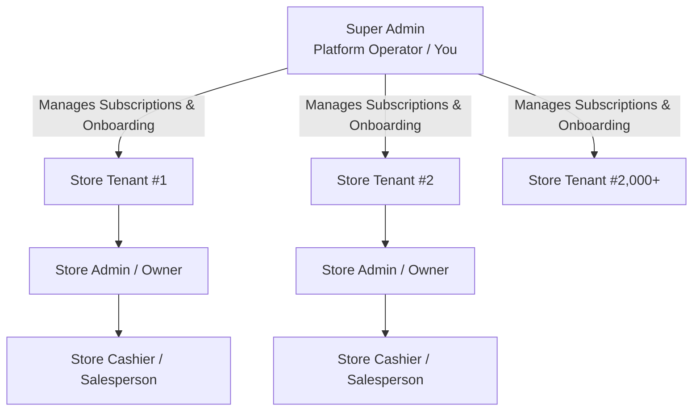

# Product Requirements Document (PRD)

## Project Name: Multi-Tenant Retail Inventory, POS & Real-Time Analytics SaaS Platform
**Document Version:** 2.0.0 (Updated for Multi-Tenant SaaS)  
**Status:** Approved for Development  
**Target Market:** Ethiopian Retail Ecosystem (Supermarkets, Boutiques, Electronics, Pharmacies, Minimarkets) & Scalable Global Multi-Tenancy  
**Scale Target:** 2,000+ Independent Store Tenants operating concurrently  
**Platforms:** Responsive Web (Desktop, Tablet POS Counter, Mobile Admin, Back-Office)  

---

## 1. Executive Summary & Problem Statement

### 1.1 Problem Statement
Retail stores in Ethiopia face unique operational and economic challenges:
1. **Foreign Exchange & High Software Costs:** Traditional cloud SaaS tools charge expensive monthly USD fees via international credit cards, which are inaccessible to most Ethiopian merchants due to foreign currency shortages.
2. **Lack of Local Payment Integration:** Generic international POS systems fail to support native Ethiopian payment rails (**Telebirr, CBE Birr, Safaricom M-Pesa Ethiopia**).
3. **Inventory & True Profit Blindness:** Store owners only monitor top-line gross sales without factoring in changing supplier purchase costs (COGS) or line discounts, leading to inaccurate profit estimation.
4. **Counter Queues & Shrinkage:** Slow manual checkout, barcode sticker damage, and lack of counter-level access restrictions create long queues and internal theft risks.

### 1.2 System Vision
A high-performance, cost-effective, **Multi-Tenant B2B SaaS Platform** designed to power **2,000+ independent businesses** concurrently. Each store operates in total isolation with its own private catalog, inventory ledger, staff logins, and financial analytics, while the platform owner oversees subscriptions and platform health from a unified Super Admin portal.

---

## 2. Multi-Tenant User Roles & Personas

### 2.1 Role 1: Super Admin (Platform Operator / You)
* **Scope:** Entire SaaS platform across all 2,000+ tenants.
* **Responsibilities:** Onboarding new store tenants, configuring subscription plans (Trial, Starter, Pro), tracking platform subscription revenue in ETB, monitoring tenant health, activating/suspending store accounts.
* **Access Level:** Global system visibility; no visibility into sensitive operational customer receipt items unless authorized for support.

### 2.2 Role 2: Store Admin (Store Owner / General Manager)
* **Scope:** Single store tenant.
* **Responsibilities:** Managing store catalog, setting selling prices and private purchase costs (COGS), inward stock receiving, dead stock clearance, low stock reordering, creating cashier accounts, reviewing daily net profit.
* **Access Level:** Complete administrative control over their own store; **zero access** to any other tenant's data.

### 2.3 Role 3: Store Cashier (Salesperson / Counter Attendant)
* **Scope:** Counter terminal of an assigned store.
* **Responsibilities:** Rapid barcode/QR scanning, customer cart management, applying capped discounts, accepting split payments (Cash, Telebirr, CBE Birr, M-Pesa), and printing thermal receipts.
* **Access Level:** Strictly restricted to the POS screen. **Never** sees product cost prices or store profit margins. Cannot modify prices or delete products.

---

## 3. Core Modules & Functional Requirements

### Module 1: Multi-Tenancy & Store Provisioning Engine
* **FR-1.1 Tenant Isolation:** Every store operates with an independent data boundary identified by `store_id`. All database queries, caches, and websocket channels are strictly scoped by tenant.
* **FR-1.2 Store Onboarding:** Super Admin or self-service signup allows quick store creation with store name, phone, address, currency (default: **ETB / ብር**), and initial admin user.
* **FR-1.3 Subscription Management:** Configurable billing tiers (e.g., Free 14-day Trial, Standard @ 500 ETB/mo, Pro @ 1,000 ETB/mo). Super Admin can activate, extend, or suspend store accounts based on Telebirr/CBE Birr bank payment verification.

### Module 2: Product Master & Tenant Inventory Control
* **FR-2.1 Tenant-Scoped Product Master:** Products, categories, and barcodes are isolated per store. Store A and Store B can have identical barcodes (e.g., manufacturer UPCs) without conflicts (`@@unique([store_id, barcode])`).
* **FR-2.2 Private Cost Price (COGS):** Hidden purchase cost per item. Sanitized at the API controller level—cashier tokens never receive cost data.
* **FR-2.3 Stock Inwarding & Ledger:** Inward stock additions (`+50 units`) write an immutable `StockMovement` row with unit cost and supplier note.
* **FR-2.4 Low Stock Alerts:** Dynamic notification badge when an item's quantity reaches or drops below its `low_stock_threshold` (e.g., < 5 units).
* **FR-2.5 Dead Stock Detector:** Identifies items in the store's inventory with zero sales in the last 30, 60, or 90 days.

### Module 3: Point of Sale (POS) & Dual Hardware Scanner
* **FR-3.1 Global Keyboard-Wedge Scanner:** Intercepts USB/Bluetooth laser scanner inputs (`Enter`-terminated keystroke bursts in <100ms) from anywhere on the screen and adds the matching item to the active cart within 50ms.
* **FR-3.2 Integrated Camera QR Scanner:** Web/device camera viewfinder using `html5-qrcode` with live reticle for mobile tablets and laptops lacking laser guns.
* **FR-3.3 Instant Debounced Search:** Search by product name or SKU with category filter chips for manual selection if barcode stickers are unreadable.
* **FR-3.4 Cart Controls & Discount Limits:** Increment/decrement quantity, remove items, and apply line/order discounts. System enforces a Store Admin-defined discount ceiling (e.g., maximum 15%).

### Module 4: Ethiopian Payment Processing & Split Tender
* **FR-4.1 Supported Payment Rails:**
  * **Cash:** Quick ETB denomination buttons (10, 50, 100, 200 ETB) with instant Change Due calculation.
  * **Telebirr:** Direct recording of customer Telebirr transaction confirmation code.
  * **CBE Birr:** Direct recording of Commercial Bank of Ethiopia mobile money reference code.
  * **Safaricom M-Pesa:** Recording of Safaricom M-Pesa Ethiopia transaction code.
  * **Card / Store Credit:** Supported for boutique and hotel gift retail.
* **FR-4.2 Split Payments:** Allows combining payment types on a single order (e.g., 200 ETB Cash + 350 ETB Telebirr).

### Module 5: Sales Analytics, Revenue & True Profit Engine
* **FR-5.1 Real-Time Store Dashboard:** Today's Gross Sales, Total Orders, Average Basket Value, Cost of Goods Sold (COGS), and True Net Profit.
* **FR-5.2 Historical Cost Snapshotting:**
  $$\text{Line Net Profit} = (\text{Selling Price} - \text{Line Discount} - \text{Unit Cost at Sale}) \times \text{Quantity}$$
  Every order line item captures the item's purchase cost at that exact millisecond, ensuring historical reporting accuracy remains 100% true regardless of future supplier price shifts.
* **FR-5.3 Category Margins:** Profit margin analysis by product category (e.g., Groceries: 18%, Electronics: 25%, Clothing: 45%).
* **FR-5.4 Staff Ranking:** Tracks sales revenue, item volume, and transaction count per cashier shift.

### Module 6: Hardware Output & Receipt Printing
* **FR-6.1 Thermal Receipt Generator:** Optimized CSS print stylesheet and raw text formatting for 58mm and 80mm thermal receipt roll printers.
* **FR-6.2 Ge'ez (Amharic) & English Compatibility:** UTF-8 support ensures Amharic item names and Ethiopian Birr currency symbols (ብር / ETB) print clearly without font corruption.
* **FR-6.3 Printable QR Sticker Sheet Generator:** Store Admin can generate and print formatted sticker sheets of QR codes ready to peel and stick onto retail merchandise.

### Module 7: Super Admin Platform Oversight (SaaS Operator Hub)
* **FR-7.1 Global Platform Telemetry:** Total active stores, total platform gross merchandise volume (GMV), active cashiers, and system uptime.
* **FR-7.2 Tenant Directory & Actions:** Searchable list of all 2,000+ stores with instant 1-click status toggle (Active, Suspended, Grace Period).
* **FR-7.3 Subscription Revenue Tracker:** Summary of monthly SaaS subscription dues collected via Telebirr, CBE Birr, or Bank Transfer.

---

## 4. Non-Functional Requirements (NFRs) for 2,000+ Tenants

| Category | Requirement | Target Metric |
| :--- | :--- | :--- |
| **Concurrency & Scale** | Concurrent active stores supported | 2,000+ independent tenants |
| **Throughput** | Platform peak transactions per second (TPS) | 50+ sustained writes/sec, 500+ reads/sec |
| **Response Time** | POS barcode scan-to-cart latency | < 50 ms |
| **Response Time** | POS checkout completion latency | < 250 ms |
| **Hosting Cost** | Monthly server infrastructure expense | < \$40 USD / month on a single standard VPS |
| **Data Isolation** | Cross-tenant data leakage | **Zero tolerance (0%)** enforced at database query layer |
| **Security** | Password hashing | Bcrypt (salt rounds: 12) |
| **Security** | Role-based data masking | Complete server-side omission of `cost_price` for cashiers |
| **Resilience** | Offline resilience at checkout | Local catalog caching via TanStack Query and IndexedDB |

---

## 5. Scope Boundaries

### In Scope (Current Delivery)
* Full Multi-Tenant data isolation with `store_id` on all entities.
* Super Admin platform management portal (Tenant list, subscriptions, platform stats).
* Store Admin management portal (Products, hidden COGS, inventory ledger, analytics, QR stickers).
* Store Cashier POS counter (Keyboard wedge scanner, camera scanner, split payments, receipts).
* Ethiopian payment rails (Cash with change, Telebirr, CBE Birr, Safaricom M-Pesa).
* Currency formatting for Ethiopian Birr (ETB / ብር) and UTF-8 Amharic text support.
* Prisma schema optimized for PostgreSQL (and zero-setup local development with SQLite).

### Out of Scope (Future Phases)
* Automated Ethiopian Customs Authority (ERCA / MOR) fiscal printer electronic transmission.
* Automated AI-driven demand forecasting.
