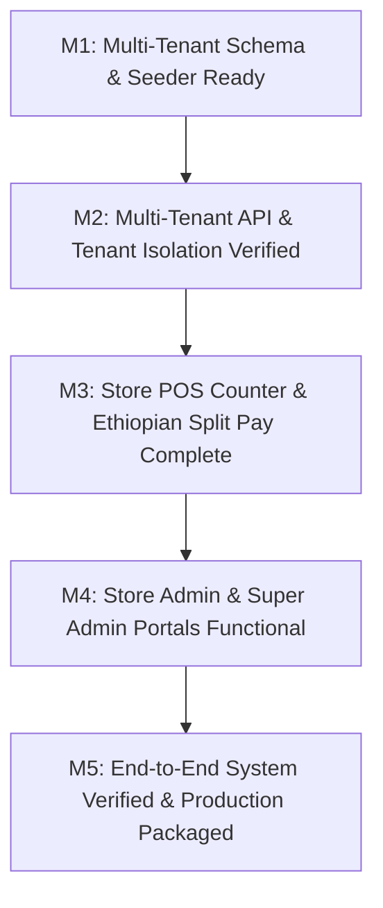

# Implementation Plan (Plan.md)

## Project: Multi-Tenant Retail Inventory, POS & Real-Time Analytics SaaS Platform
**Target Scale:** 2,000+ Independent Store Tenants  
**Architecture:** Monorepo (`backend/` + `frontend/`) with Row-Level Multi-Tenancy  
**Backend:** Node.js, Express, TypeScript, Prisma ORM, PostgreSQL (and SQLite for local dev), JWT, Zod  
**Frontend:** React, Vite, TypeScript, Tailwind CSS, Lucide Icons, TanStack Query, html5-qrcode  
**Status:** In Progress — Pre-Development Scaffolding  

---

## 1. Project Phasing & Multi-Tenant Task Breakdown

### Phase 1: Multi-Tenant Foundation & Data Architecture
* **Task 1.1: Monorepo Scaffolding:**
  * Configure root directory scripts for building and running both services.
  * Initialize `backend/` with Express, TypeScript, and Prisma ORM.
  * Initialize `frontend/` with Vite, React, TypeScript, and Tailwind CSS.
* **Task 1.2: Multi-Tenant Prisma Schema Design:**
  * Define models: `Store`, `Subscription`, `User`, `Product`, `StockMovement`, `SalesOrder`, `SaleItem`, `Payment`, `AuditLog`.
  * Establish foreign keys to `store_id` on all business entities.
  * Configure composite unique indexes:
    * `@@unique([store_id, barcode])`
    * `@@unique([store_id, sku])`
    * `@@unique([store_id, receipt_number])`
* **Task 1.3: Multi-Tenant Seeder Engine:**
  * Create `seed.ts` populating:
    * 1 Platform Super Admin (`superadmin@saas.com` / `admin123`).
    * 2 Realistic Independent Ethiopian Stores:
      1. **Bole Supermarket** (Active subscription, 15+ Grocery products, 1 Store Admin, 2 Cashiers, 30 days of sales history).
      2. **Piazza Electronics** (Trial subscription, 10+ Electronics products, 1 Store Admin, 1 Cashier).
    * Test verification that Bole Supermarket and Piazza Electronics share zero data.

### Phase 2: Secure Multi-Tenant REST API & RBAC
* **Task 2.1: Authentication & Tenant Resolution Middleware:**
  * `/api/auth/login`: Issues JWT containing `{ id, email, role, storeId }`.
  * Middleware `requireAuth`: Verifies token.
  * Middleware `requireRole(['SUPER_ADMIN' | 'STORE_ADMIN' | 'CASHIER'])`: Enforces permissions.
  * Middleware `tenantResolver`: Injects `where: { store_id: req.user.storeId }` into all Prisma operations for store users.
  * Middleware `cogsSanitizer`: Strips `cost_price` and profit fields if role is `CASHIER`.
* **Task 2.2: Super Admin Platform Endpoints:**
  * `GET /api/super-admin/stats`: Total stores, active cashiers, platform GMV, monthly subscription revenue in ETB.
  * `GET /api/super-admin/tenants`: List all 2,000+ stores with search, plan status, and payment logs.
  * `POST /api/super-admin/tenants/:id/activate`: Approve Telebirr / CBE Birr subscription payment and extend expiration date.
* **Task 2.3: Store Catalog & Stock Ledger Endpoints:**
  * `GET /api/products`: Scoped product list with search and category filtering.
  * `GET /api/products/barcode/:code`: Fast sub-50ms barcode lookup.
  * `POST /api/products`: Create product with selling and private cost price.
  * `POST /api/products/:id/adjust-stock`: Inward stock receipt or shrinkage adjustment with atomic `StockMovement` logging.
* **Task 2.4: Atomic POS Checkout Engine:**
  * `POST /api/orders/checkout`:
    * Verifies stock availability for that specific `store_id`.
    * Enforces discount limits.
    * Executes Prisma `$transaction` (Order + Sale Items with snapshot COGS + Split Payments [Cash/Telebirr/CBE Birr] + Negative Stock Movements + Product Stock decrement).
* **Task 2.5: Store Analytics & Intelligence (Store Admin):**
  * `GET /api/analytics/dashboard`: Today's revenue in ETB, COGS, True Net Profit, Orders, AOV.
  * `GET /api/analytics/dead-stock`: Products with 0 sales in 30/60/90 days.
  * `GET /api/analytics/low-stock`: Products where `current_stock <= low_stock_threshold`.
  * `GET /api/analytics/staff`: Cashier sales totals and transaction counts.

### Phase 3: Salesperson POS Counter UI
* **Task 3.1: POS Shell & Barcode Wedge Integration:**
  * Global keystroke buffer capturing USB/Bluetooth laser scanner inputs instantly (<50ms).
  * Fast keyboard shortcuts (`F2` search, `Space` checkout, `Esc` dismiss).
* **Task 3.2: Camera QR Viewfinder:**
  * Integrated webcam and tablet camera QR decoder using `html5-qrcode`.
* **Task 3.3: Cart & Ethiopian Split Payment Modal:**
  * Tactile cart with increment/decrement, remove, and discount controls.
  * Split tender modal: Cash with ETB quick buttons (50, 100, 200 ETB) + Telebirr confirmation code field + CBE Birr code field.
  * Real-time Change Due calculator.
* **Task 3.4: 58mm & 80mm Thermal Receipt Printing:**
  * CSS `@media print` formatted layout.
  * UTF-8 Ge'ez (Amharic) and English compatibility with ETB / ብር symbols.

### Phase 4: Store Admin & Super Admin Web Portals
* **Task 4.1: Store Admin Analytics & Catalog Hub:**
  * Real-time KPI cards: Today's Revenue, COGS, True Net Profit, Profit Margin %.
  * Dead-stock clearance table and Low-stock restock alert badges.
  * Product Master table with private Cost Price and inline stock adjustments.
* **Task 4.2: Printable QR Sticker Sheet Generator:**
  * Select products and print formatted sticker sheets (3x8 grid or label rolls) with item name, SKU, price in ETB, and QR code.
* **Task 4.3: Super Admin Platform Oversight Portal:**
  * High-level dashboard showing total platform stores, active subscriptions, and monthly Telebirr/CBE revenue.
  * Store directory with 1-click status activation/suspension.

### Phase 5: Verification, Multi-Tenant Testing & Packaging
* **Task 5.1: Cross-Tenant Data Isolation Test:**
  * Verify that Cashier or Admin from Store A gets `404 Not Found` when trying to access Store B's product, order, or customer receipt.
* **Task 5.2: Security & Zero-Leak Validation:**
  * Confirm Cashier tokens receive no `cost_price` in any API response.
* **Task 5.3: Build Pipeline & One-Command Startup:**
  * Verify `npm run build` succeeds cleanly for both backend and frontend.
  * Provide comprehensive `.env.example` and documentation.

---

## 2. Milestone Schedule & Verification Gates

| Milestone | Deliverables | Verification Gate |
| :--- | :--- | :--- |
| **M1: Multi-Tenant Core** | Prisma schema with `store_id`, seed script with 2 independent stores | Database seeds 2 distinct stores; composite indexes verified. |
| **M2: Secure API** | Auth, Tenant Resolver, Catalog, Checkout, Analytics APIs | Automated tests confirm zero cross-tenant leakage; cashier role scrubbing verified. |
| **M3: POS Counter** | React POS screen, wedge scanner, camera scanner, Ethiopian split pay, receipts | Barcode scan adds to cart; Telebirr/Cash split payment executes atomically; receipt prints cleanly. |
| **M4: Admin Portals** | Store Admin analytics & QR sticker generator + Super Admin platform manager | Store Admin sees true net profit in ETB; Super Admin manages all store subscriptions. |
| **M5: Production Ready** | Error handling, performance testing, deployment configs | Clean production builds, complete setup guide, zero cross-tenant security vulnerabilities. |
