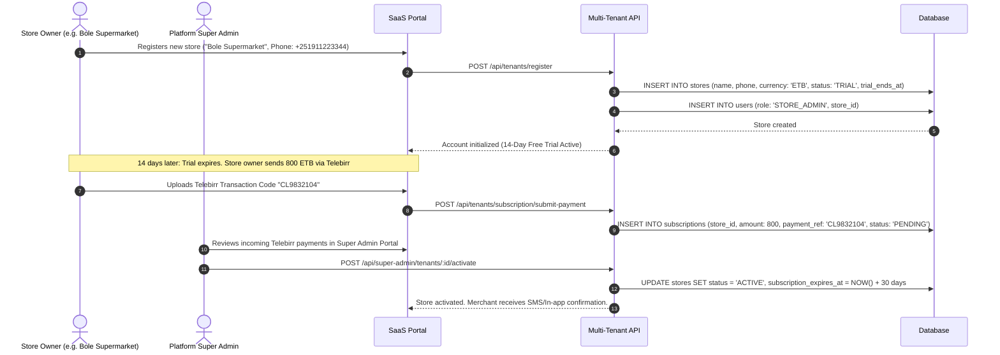
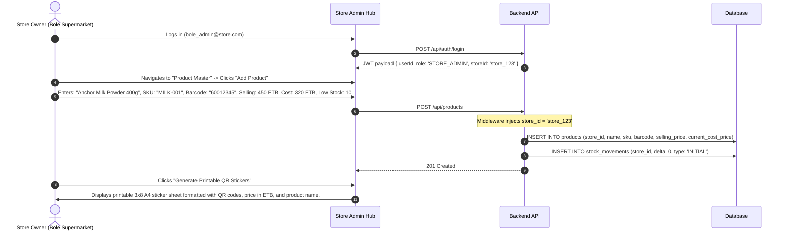
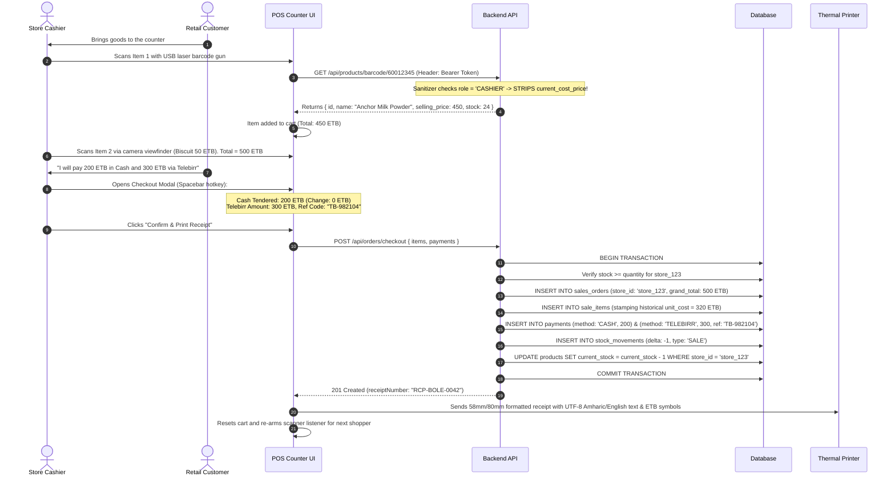
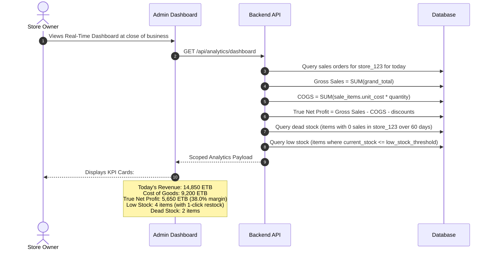
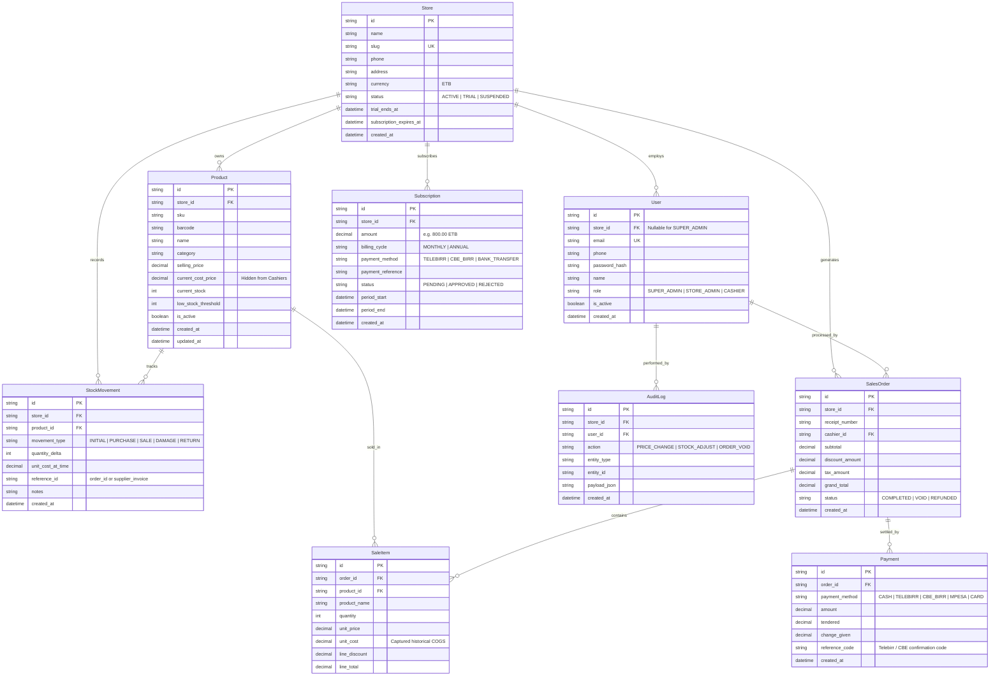

# System Design Document (System-Design.md)

## Project: Multi-Tenant Retail Inventory, POS & Real-Time Analytics SaaS Platform
**Document Version:** 2.0.0 (Updated for Multi-Tenant SaaS)  
**Scale Target:** 2,000+ Independent Store Tenants  
**Architectural Style:** Multi-Tenant Shared-Database / Pooled-Schema Architecture with Row-Level Isolation  
**Primary Stack:** TypeScript / Node.js (Express) + React (Vite) + Tailwind CSS + Prisma ORM + PostgreSQL / SQLite  

---

## 1. Multi-Tenant System Architecture

```mermaid
graph TB
    subgraph Client Tier
        SuperAdminUI["Super Admin Portal<br/>(Platform Metrics, Tenant Directory, Subscription Billing)"]
        StoreAdminUI["Store Admin Hub<br/>(Store Products, Hidden COGS, QR Generator, Staff, Profit)"]
        StorePosUI["Store POS Counter<br/>(Wedge Scanner, Camera, Cart, Ethiopian Split Pay, Thermal Print)"]
    end

    subgraph Edge & Gateway Tier
        Proxy["Reverse Proxy (Nginx / Cloudflare)<br/>SSL Termination, Gzip, Rate Limiting"]
        Gateway["Express Multi-Tenant API Gateway"]
        AuthService["Auth & JWT Service<br/>(Issues Claims: userId, role, storeId)"]
        TenantResolver["Tenant Resolution Middleware<br/>(Extracts storeId & Enforces Query Scoping)"]
        Sanitizer["COGS Security Sanitizer<br/>(Strips cost_price for Cashier role)"]

        Proxy --> Gateway
        Gateway --> AuthService
        Gateway --> TenantResolver
        TenantResolver --> Sanitizer
    end

    subgraph Application Services Tier
        TenantService["Store & Subscription Service"]
        ProductService["Product & Catalog Service (Scoped by storeId)"]
        LedgerService["Stock Movement Ledger Service (Scoped by storeId)"]
        OrderService["Atomic Checkout & Payment Service (Scoped by storeId)"]
        AnalyticsService["Profit & Analytics Engine (Scoped by storeId)"]

        Sanitizer --> TenantService
        Sanitizer --> ProductService
        Sanitizer --> LedgerService
        Sanitizer --> OrderService
        Sanitizer --> AnalyticsService
    end

    subgraph Data Tier (Prisma ORM + PostgreSQL)
        DB[(PostgreSQL Database<br/>Composite Indexes on store_id)]
        ConnectionPool["PgBouncer / Connection Pooler"]

        ProductService --> ConnectionPool
        LedgerService --> ConnectionPool
        OrderService --> ConnectionPool
        AnalyticsService --> ConnectionPool
        TenantService --> ConnectionPool
        ConnectionPool --> DB
    end
```

---

## 2. Multi-Tenancy Data Isolation Strategy (2,000+ Stores)

To host 2,000+ stores affordably on a single modest server without sacrificing security or performance:

### 2.1 The Discriminator Pattern (Row-Level Security)
* Every operational table contains a mandatory `store_id` foreign key.
* **Prisma Query Middleware:** A centralized middleware intercepts all database queries and automatically injects `{ where: { store_id: req.user.storeId } }`.
* **Zero Cross-Tenant Leakage:** A user from Store A (`store_id = 'A'`) cannot execute queries against Store B (`store_id = 'B'`). Attempts to access another store's entities return `404 Not Found` or `403 Forbidden`.

### 2.2 Composite Unique Constraints
* Product barcodes, SKUs, and receipt numbers are unique **per store**, not globally. Two different stores can sell items with the exact same manufacturer barcode without collision:
  ```prisma
  @@unique([store_id, barcode])
  @@unique([store_id, sku])
  @@unique([store_id, receipt_number])
  ```

### 2.3 High-Performance Indexing Strategy for 2,000 Tenants
To keep query execution times below 10ms across 2,000 stores:
1. `CREATE INDEX idx_products_store_barcode ON products(store_id, barcode);`
2. `CREATE INDEX idx_sales_orders_store_date ON sales_orders(store_id, created_at DESC);`
3. `CREATE INDEX idx_stock_movements_store_product ON stock_movements(store_id, product_id, created_at DESC);`

---

## 3. Point-to-Point Detailed Workflows

### Workflow 1: Store Tenant Onboarding & Ethiopian Subscription Activation


---

### Workflow 2: Store Admin Catalog & Hidden Cost Setup


---

### Workflow 3: Cashier Counter Checkout with Ethiopian Payment Rails (Split Tender)


---

### Workflow 4: Executive Business Analytics & True Profit Calculation


---

## 4. Multi-Tenant Database Schema (ERD)



---

## 5. Security & Multi-Tenancy Invariant Rules

1. **Strict Tenant Query Scoping:** Every SQL/Prisma query against business entities must contain `store_id: req.user.storeId`. Cross-tenant querying is an immediate security fault.
2. **Confidential COGS Rule:** The `cost_price` and derived profit margins are stripped server-side whenever the authenticated user's role is `CASHIER`.
3. **Atomic Sales Transactions:** Checkouts execute in a single ACID transaction (`$transaction`). If stock is insufficient or a payment tender fails, the order and stock deduction are rolled back atomically.
4. **Historical COGS Stamping:** Every `SaleItem` stores a snapshot of the unit purchase cost at the moment of checkout, ensuring historical profitability analytics are never altered by subsequent supplier price increases.
